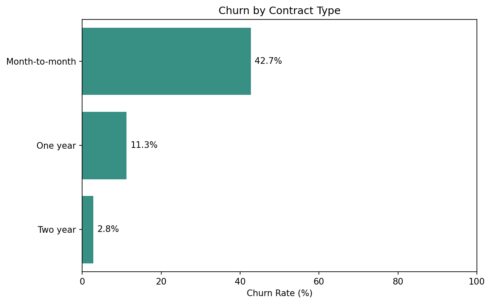

# Telecom Customer Churn Prediction — Machine Learning & Retention Analysis

Este proyecto analiza el abandono de clientes (*churn*) en una empresa de telecomunicaciones para identificar segmentos asociados a mayores tasas de cancelación y explorar cómo el aprendizaje automático (*machine learning*) puede apoyar las estrategias de retención.

El análisis combina el análisis exploratorio de datos, la segmentación de clientes y la clasificación mediante LightGBM, haciendo hincapié en obtener información empresarial accionable y en una evaluación transparente del modelo.

## Objetivos empresariales

- Identificar segmentos de clientes con mayores tasas de abandono.

- Explorar las relaciones entre el abandono, los tipos de contrato, los servicios de internet y los métodos de pago.

- Evaluar modelos de aprendizaje automático para la clasificación retrospectiva del abandono.

- Ofrecer recomendaciones basadas en datos para fomentar la retención de clientes.

## Conjunto de datos

El conjunto de datos contiene 7.043 registros de clientes, incluyendo detalles del contrato, servicios contratados, información de facturación y características demográficas.

La tasa de abandono observada en general es del 26,54 %.

## Acceso al conjunto de datos y reproducibilidad

Este proyecto utiliza el conjunto de datos de clientes de la empresa de telecomunicaciones Interconnect, proporcionado como parte del programa de Ciencia de Datos de TripleTen.

El conjunto de datos original no se incluye en este repositorio, ya que no se han verificado los permisos para su redistribución.

El Jupyter Notebook contiene el código de análisis, los resultados de su ejecución, visualizaciones, los resultados de la evaluación del modelo y recomendaciones de negocio, lo que permite a los revisores examinar la metodología y los hallazgos sin necesidad de descargar los datos originales.

Para reproducir el análisis, los usuarios autorizados deben obtener el conjunto de datos original a través de los materiales de su curso y colocar los siguientes archivos en el directorio `data/raw/`:

contract.csv

internet.csv

personal.csv

phone.csv

## Herramientas y tecnologías

Python · Pandas · NumPy · Matplotlib · Seaborn · Scikit-learn · LightGBM · Jupyter Notebook

## Hallazgos clave

- Contratos mensuales: 42,7 % de abandono, frente al 11,3 % en contratos de un año y el 2,8 % en contratos de dos años.

- Clientes con fibra óptica: 41,9 % de abandono.

- Pagos con cheque electrónico: 45,3 % de abandono.

- Características de los clientes: Los clientes que abandonan el servicio suelen tener cargos mensuales más elevados y una antigüedad estimada menor.

**Key Insight:** Month-to-month contracts showed a 42.7% churn rate, compared to 11.3% for one-year contracts and 2.8% for two-year contracts. Contract type is strongly associated with customer churn and may help inform retention strategies.

## Resultados del modelado predictivo

Se evaluaron dos modelos LightGBM:

| Metric | Initial Model | Adjusted Model |
|:---|---:|---:|
| ROC-AUC | 0.9344 | 0.8110 |
| Recall | 0.7388 | 0.4989 |
| Precision | 0.8712 | 0.5825 |
| F1-score | 0.7995 | 0.5375 |

## Model Interpretation

The initial LightGBM model achieved a recall of 0.7388, correctly identifying approximately 74% of customers who actually churned. In contrast, the adjusted model achieved a recall of 0.4989, identifying approximately 50% of actual churn cases.

The initial model also performed better in ROC-AUC, precision, and F1-score. These results suggest that the initial model is the stronger candidate for identifying customers at risk of leaving.

From a business perspective, the initial model could help prioritize customer retention efforts. However, it still misses approximately 26% of customers who actually churn, so its predictions should support rather than replace business decisions.

## Recomendaciones empresariales

1. Evaluar incentivos de retención dirigidos a clientes con contratos mensuales (sin permanencia).

2. Investigar la calidad del servicio y las experiencias de soporte entre los clientes de fibra óptica.

3. Revisar las experiencias de facturación asociadas a los pagos mediante cheque electrónico.

4. Explorar estrategias de vinculación temprana para clientes recientes con cargos mensuales más elevados.

## Limitaciones

El conjunto de datos no contiene medidas directas de satisfacción del cliente, reclamaciones o calidad del servicio. Por lo tanto, las relaciones observadas no deben interpretarse como causas confirmadas de la pérdida de clientes (*churn*).

La evaluación del modelo es retrospectiva y no determina su rendimiento predictivo futuro.

## Conclusión

Este proyecto demuestra cómo el análisis de clientes y el aprendizaje automático pueden ayudar a identificar segmentos de clientes de alto riesgo, evaluar patrones predictivos y transformar los hallazgos analíticos en recomendaciones prácticas para la retención.